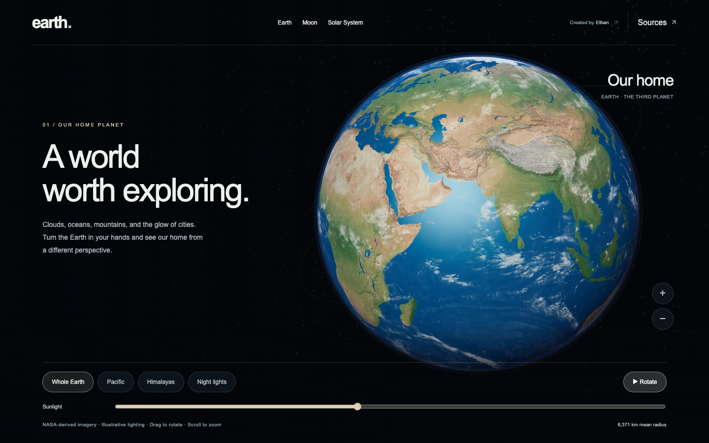

# Earth, Moon & Solar System

Explore our home planet, cross to the Moon, and travel through the solar system—all in your browser.

A Three.js experience by **[Ethan Rogers](https://x.com/ethanplusai)**, with photographic planetary surfaces, lunar terrain, and NASA/JPL orbital data.

**[Explore earth.ethanplus.ai](https://earth.ethanplus.ai)** · [Run locally](#run-locally) · [Data & credits](CREDITS.md) · [MIT license](LICENSE)



## Three places to explore

| Earth | Moon | Solar System |
| --- | --- | --- |
| Rotate a photographic globe, approach mountains and coastlines, and adjust the sunlight. | Explore the near side, far side, and south pole using NASA lunar imagery and elevation. | Travel among all eight planets and 21 selected moons with dated orbital motion. |
| Surface relief, clouds, atmosphere, and night lights. | Adjustable lighting, terrain detail, and a guided camera tour. | Planet and moon views, playback controls, orbital paths, and a true-scale option. |

Smooth Earth–Moon–Solar System transitions connect the views. The star field uses measured star positions. Desktop and phone layouts include labeled controls, touch interaction, and support for reduced-motion preferences.

This repository contains the standalone Earth, Moon, and Solar System experience. The live project at **earth.ethanplus.ai** includes additional explorations.

## Run locally

You need **Node.js 22.12 or newer** and a modern browser with WebGL support.

```sh
git clone https://github.com/ethanplusai/earth-moon-solar.git
cd earth-moon-solar
npm ci
npm run dev
```

Open **http://localhost:5173**, or the address printed in your terminal if that port is occupied.

No accounts, API keys, or environment variables are required. All imagery and orbital data are bundled, so the running application does not need third-party requests. Installation downloads dependencies from npm.

### Controls

- **Earth:** drag to rotate, scroll or pinch to zoom, choose a geographic view, and move the Sunlight slider.
- **Moon:** drag to rotate, scroll or pinch to zoom, choose a terrain view, or press Play for a camera tour.
- **Solar System:** drag to orbit, scroll or pinch to approach, select a planet or moon, and change the date or playback speed. Switch to True scale to restore physical sizes and distances.
- **On phones:** open **View controls** on Earth and Moon, or **Controls** in the Solar System. **Explore** switches pages and opens the source notes.

## Build and deploy

```sh
npm run build
npm run preview
```

The production website is written to `dist/`. Serve that folder at the root of a domain on a static host. Keep `index.html`, `moon.html`, `solar.html`, and the bundled assets together. The app uses root-relative asset paths; hosting under a repository subpath requires adjusting those paths.

## What the visualization represents

**Orbital coverage:** 1 January 2026 through 1 January 2027. NASA/JPL Horizons positions and velocities are sampled daily for planets and hourly for moons, then interpolated. Playback remains within this interval; it is not a live feed.

**Scale:** the illustrated overview compresses distances and enlarges bodies for legibility. True scale restores physical radii and distances. Earth–Moon transitions use a staged composition.

**Surfaces and lighting:** Earth and Moon imagery are static composites. Cloud motion, sunlight, surface rotation, axial orientation, and exposure are illustrative. Most smaller moons use schematic surfaces. The project includes all eight planets and selected moons, rather than every solar-system object.

The experience is intended for exploration and education, not navigation or precise sky prediction. See [orbital data notes](public/data/solar/README.md), [lunar imagery notes](public/data/moon/README.md), and [source credits](CREDITS.md) for details.

## Development

The project uses JavaScript modules, Three.js, and Vite. Each page has its own entry point:

| File | Purpose |
| --- | --- |
| `src/main.js` | Earth views and controls |
| `src/moon.js` | Lunar globe and camera tour |
| `src/solar.js` | Solar-system rendering and interaction |
| `src/scene.js` | Shared Earth rendering and lighting |
| `src/solar-model.js` | Orbital interpolation and reference paths |
| `public/` | Bundled textures, datasets, and source notes |

Run the unit checks with `npm test`. For browser checks, install Chromium and start the development server:

```sh
npx playwright install chromium
npm run dev
```

In another terminal:

```sh
npm run test:release
npm run test:solar
npm run test:moon
npm run test:journeys
npm run test:stars
```

Tests cover asset loading, navigation, desktop and mobile controls, orbital interpolation, playback, page transitions, and star-field stability. Browser tests expect port 5173; set `TEST_URL` and `TEST_DEV_URL` to use another address. Set `CHROMIUM_PATH` to select an existing Chromium executable.

Optional data preparation scripts live in `scripts/`. Python is not required to install or run the site. Contributions are welcome; include a clear description and, for visual changes, desktop and mobile screenshots.

## License and attribution

Original application code is **MIT licensed**, copyright © 2026 Ethan Rogers. You may use, modify, and redistribute it under the [MIT license](LICENSE); retain the copyright and license notice.

Third-party imagery and datasets retain their own terms. Solar System Scope textures are **CC BY 4.0**; the adapted HYG star dataset is **CC BY-SA 4.0**. The code license does not replace these asset licenses. See [CREDITS.md](CREDITS.md) for the complete attribution list and source links.
